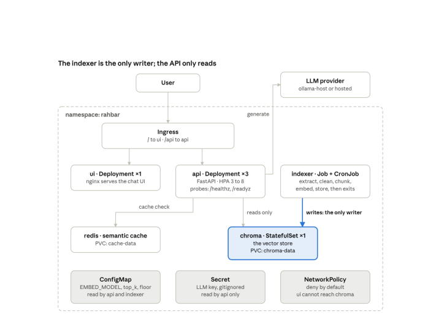
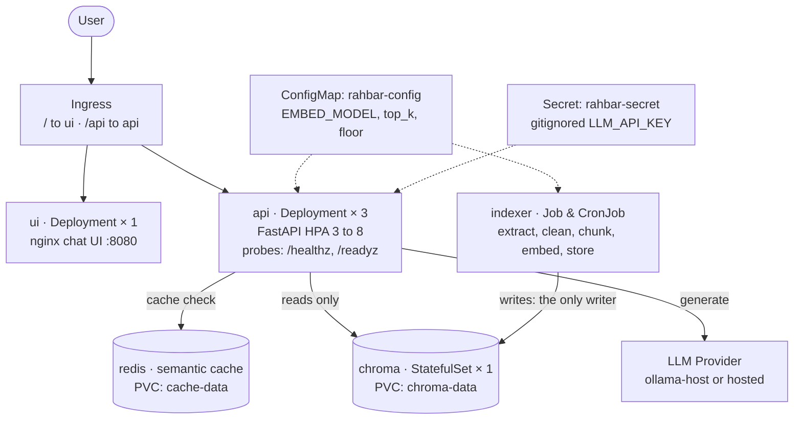

# RAHBAR: Grounded RAG on Kubernetes


RAHBAR is a production-grade question-answering service over a real document corpus, deployed on Kubernetes. It grounds every response in retrieved evidence from university policies, strictly cites sources, enforces Pydantic schemas, and refuses out-of-scope queries.

---

## Architecture

> **"Indexing runs once, and again when the material changes; querying runs on every question."**

The architecture completely separates the **Writer** (the indexer batch Job) from the **Reader** (the FastAPI query service), sharing only an immutable vector collection and an embedding model contract.





---

## API Endpoints

The API is served at `http://rahbar.local/api`:

| Method | Path | Purpose | Description |
|---|---|---|---|
| POST | `/api/ask` | Query endpoint | Accepts `{"question": "..."}` (3 to 500 chars). Returns grounded answer, citations, confidence, and retrieved passages. |
| GET | `/healthz` | Liveness probe | Verifies process liveness. Never touches Chroma, Redis, or LLM to prevent restart cascades. |
| GET | `/readyz` | Readiness probe | Validates Chroma reachability, non-empty collection, Redis reachability, and embedding model pin match. |
| GET | `/metrics` | Prometheus metrics | Request count, latency histograms, cache hit ratio, fallback count, and token counters. |

---

## Quickstart & Local Cluster Setup

### Prerequisites
- Docker
- Minikube or Kind
- `kubectl`
- Python 3.12+

### 1. Cluster Startup Instructions
Start minikube with Calico CNI (required for NetworkPolicy enforcement) and enable the required addons:

```bash
# Start minikube with 6GB RAM, 4 CPUs, and Calico network plugin
minikube start --driver=docker --cni=calico --memory=6144 --cpus=4

# Enable metrics-server (required by HPA) and ingress
minikube addons enable metrics-server
minikube addons enable ingress
```

### 2. Local LLM Setup (Ollama)
Run Ollama on the host machine listening on all interfaces:

```bash
OLLAMA_HOST=0.0.0.0 ollama serve
ollama pull llama3.2:3b
ollama pull nomic-embed-text
```

### 3. Build Container Images
Build the three service images and load them into minikube:

```bash
make images
```

---

## The Exact Apply Order

Apply the manifests in the documented order from a clean clone:

```bash
# 1. Create the dedicated namespace
kubectl apply -f k8s/base/namespace.yaml

# 2. Create the Secret from the command line (never commit real secrets)
kubectl create secret generic rahbar-secret -n rahbar \
  --from-literal=LLM_API_KEY="${LLM_API_KEY:-placeholder}" \
  --dry-run=client -o yaml | kubectl apply -f -

# 3. Apply the ConfigMap (runtime settings, embedding pin)
kubectl apply -f k8s/base/configmap.yaml

# 4. Apply NetworkPolicies (deny-by-default, allow specific routes)
kubectl apply -f k8s/base/networkpolicy.yaml

# 5. Deploy Persistent Storage and Data Tiers (Chroma StatefulSet & Redis Deployment)
kubectl apply -f k8s/base/chroma-statefulset.yaml
kubectl apply -f k8s/base/redis.yaml
kubectl apply -f k8s/base/services.yaml

# 6. Wait for Chroma StatefulSet to be Ready
kubectl rollout status statefulset/chroma -n rahbar --timeout=120s

# 7. Run the Indexer Job (Initial corpus ingestion)
kubectl apply -f k8s/base/indexer-job.yaml
kubectl wait --for=condition=complete job/indexer -n rahbar --timeout=300s

# 8. Deploy the Weekly Re-index CronJob
kubectl apply -f k8s/base/reindex-cronjob.yaml

# 9. Deploy Application Tier (API with 3 replicas and UI) and HPA
kubectl apply -f k8s/base/api-deployment.yaml
kubectl apply -f k8s/base/ui-deployment.yaml
kubectl apply -f k8s/base/hpa.yaml

# 10. Deploy Ingress routing (/ -> ui, /api -> api)
kubectl apply -f k8s/base/ingress.yaml

# 11. Wait for API rollout
kubectl rollout status deployment/api -n rahbar --timeout=180s
```

Alternatively, apply via Kustomize:

```bash
kubectl apply -k k8s/overlays/dev
```

---

## How to Run the Indexer

Indexing runs on demand via the batch Job. The API only reads from the vector store.

### Run on-demand re-indexing from the CronJob template:
```bash
kubectl create job --from=cronjob/reindex manual-reindex-1 -n rahbar
kubectl get jobs -n rahbar -w
```

### Run local fixture indexing for CI:
```bash
python -m pipeline.run --dummy
```

---

## Verification & Testing

```bash
# Run test suite
make test

# Run linter & type checks
make lint

# Query through the Ingress
make ask Q="What CGPA puts a student on academic warning?"

# Run evaluation gate against golden questions
make eval
```

---

## Operations & Troubleshooting Matrix

| Symptom | Root Cause | Immediate Remedy |
|---|---|---|
| `ImagePullBackOff` on locally built images | Minikube cannot access laptop Docker daemon | Run `minikube image load <image>:<tag>` and set `imagePullPolicy: IfNotPresent`. |
| API pods stuck in `0/1 READY` | Readiness probe failing due to unindexed Chroma or embedding model mismatch | Check `kubectl describe pod -n rahbar` and `kubectl logs -n rahbar -l app=api`. Run indexing Job to populate collection. |
| Ingress / CoreDNS resolution fails under NetworkPolicy | Default-deny egress policy blocks UDP/TCP port 53 packets | Apply explicit egress rule allowing port 53 to `kube-system` namespace. |
| Indexer container fails with exit code 137 | OOMKilled during OCR rasterization or batch embedding | Check `kubectl top pods -n rahbar` and raise memory limit in `indexer-job.yaml` (minimum 1Gi recommended). |
| HPA reports `<unknown>/70%` | Resource requests missing or metrics-server addon disabled | Ensure `resources.requests.cpu` is declared on pods and run `minikube addons enable metrics-server`. |
