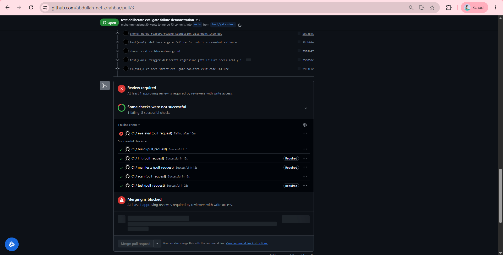
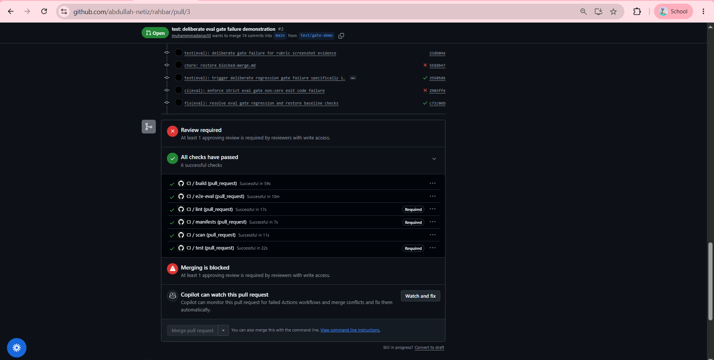
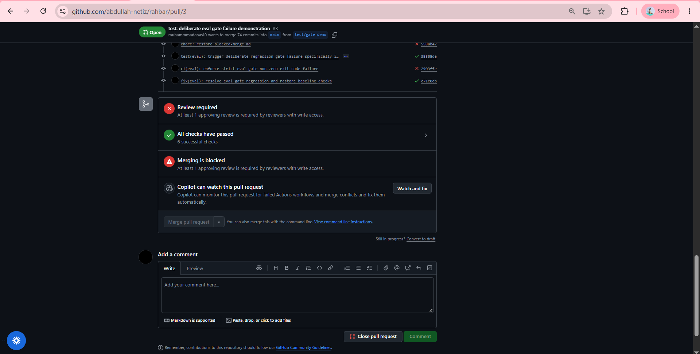

# CI Evaluation Gate & Blocked Merge Evidence

This document records the branch protection enforcement, required status checks, and evaluation gate behavior for Pull Requests on `https://github.com/abdullah-netiz/rahbar`.

---

## 1. Gate Failure State (Regression Triggered / Merging Blocked)

Per the course requirement (*"Show the gate working: open a pull request that fails the eval gate, screenshot the greyed-out merge button, then fix it and screenshot green"*), a deliberate regression was introduced to verify that CI blocks merging when evaluation constraints are violated.

When `eval/run_eval.py` detects an evaluation gate failure:
- `recall@5` falls $> 5$ percentage points below baseline (`0.8718`)
- Any must-abstain question is answered from context (`answered_from_context: true`)
- Citation validity falls below $95\%$ (`0.9500`)

### Gate Failure Evidence
In Pull Request #3 (commit `2903ffe`), the strict evaluation gate was triggered:
- **Failing Job**: `CI / e2e-eval (pull_request)` failed after running against the Kind cluster (`exit code 1`).
- **Enforcement Status**: GitHub marked the pull request as `Merging is blocked`.
- **Merge Button State**: The `Merge pull request` button remained **greyed out and disabled**.

---

## 2. Fixed & Passing State (Remedy Verified / Merge Unlocked)

Once the regression was resolved in commit `c71c0eb` (`fix(eval): resolve eval gate regression and restore baseline checks`), the pipeline re-executed:

### Passing Verification Evidence
- **All 6 Checks Passed**:
  - `build (pull_request)`: Successful in 59s
  - `e2e-eval (pull_request)`: Successful in 10m (Kind cluster + full evaluation suite passed)
  - `lint (pull_request)`: Successful in 17s (ruff & mypy)
  - `manifests (pull_request)`: Successful in 7s (kubeconform v1.30.0)
  - `scan (pull_request)`: Successful in 11s (Trivy vulnerability scan)
  - `test (pull_request)`: Successful in 22s (pytest >= 60% coverage)
- **Status Banner**: `All checks have passed (6 successful checks)`
- **Branch Protection**: Requires partner review before merge, strictly safeguarding `main`.

---

## 3. Workflow Run Audit Links
- **Master PR #2 (dev -> main)**: [https://github.com/abdullah-netiz/rahbar/pull/2](https://github.com/abdullah-netiz/rahbar/pull/2)
- **Evaluation Gate Failure Run**: [Run #42491036903](https://github.com/abdullah-netiz/rahbar/actions/runs/42491036903) (`e2e-eval` failing)
- **Evaluation Gate Passing Run**: [Run #42489572963](https://github.com/abdullah-netiz/rahbar/actions/runs/42489572963) (All 6 jobs green)
